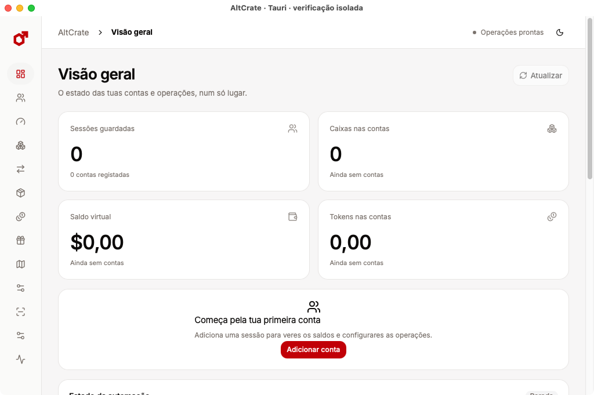

  

  <h1>AltCrate</h1>

  
<strong>A desktop workspace for Case Clicker Online.</strong> 
  Manage multiple accounts, review inventory changes, and follow operations from preparation to confirmation.

  

    
    
    
  

  

    <a href="#get-altcrate">Get AltCrate</a> ·
    <a href="#features">Features</a> ·
    <a href="docs/wiki/Home.md">Handbook</a> ·
    <a href="https://github.com/rowkavdev/AltCrate/issues">Issues</a>
  

  

  AltCrate running with an empty test profile.

## Get AltCrate

| Platform | How to get it |
| --- | --- |
| **Ubuntu 24.04 · x86-64** | Download the prerelease `.deb` and SHA-256 checksum. [Releases](https://github.com/rowkavdev/AltCrate/releases) · [Install and verify](docs/wiki/Getting-Started.md#ubuntu-2404-x86-64) |
| **macOS 14+ · Apple Silicon** | Build the ad-hoc-signed `AltCrate.app` from source. [Build and launch](docs/wiki/Getting-Started.md#apple-silicon-macos) |

AltCrate uses an unofficial game interface. Live sign-in and game operations depend on the site and the account’s eligibility. Use accounts and servers you’re authorized to operate.

## Features

### Accounts and automation

- Save and switch between up to 100 accounts. Add accounts through the sign-in window or use the account import flow.
- Search, group, and select accounts. Save operation profiles and refresh balances, case stock, tokens, and session status from Overview.
- Run case, virtual cash, and vault collection for selected accounts. Set modes per account and monitor pauses, cooldowns, and requests in flight.
- Run locally or configure an optional SSH-connected worker on your own Linux server. Server setup includes host identity verification and controls for moving execution back to the desktop.

### Opening, inventory, and conversion

- Browse case metadata and owned stock, select accounts and quantities, and follow observed stock and item changes after opening. Selected-capsule opening has offline contract coverage.
- Apply ordered item rules to keep, sell, or move qualifying results into storage. Rules can use item attributes and available ranking data. Favorites stay protected from automatic disposal.
- Browse skins and storage units with search, filters, grid or list views, and item details including float, stickers, and charms where available. Review storage creation, renaming, clearing, and removal.
- Review individual and batch actions for selling, converting, transferring, and moving items. See pending results, verify an uncertain result, and browse completed operation history.
- Use the token converter to review eligible steps, sell or convert inventory, and consolidate tokens in a destination account. Available steps depend on account state and the selected workflow.

### Progression, games, and diagnostics

- Review rewards, missions, and monthly-pass eligibility. Prepare and confirm progression batches for selected accounts.
- Inspect skill maps, review costs, and manage local skill presets. Enable the optional opening-preferences page to review eligible game-side preference changes.
- Open a multi-account games workspace for Blackjack, Coinflip, Jackpot, Case Battle, Crash, Upgrade, Dice, Plinko, and Guess the Rank. Blackjack includes table state, decision analysis, and round history.
- Inspect request metrics, compare account observations, and export persistent operation history. Activity shows current-session results and confirmations.
- Choose light or dark appearance and left-to-right or right-to-left layout.

See supported flows and verification limits in the [feature guide](docs/wiki/Feature-Guide.md).

## Learn and contribute

| Guide | What it covers |
| --- | --- |
| [Getting started](docs/wiki/Getting-Started.md) | Install, verify the download, and connect a first account |
| [Feature guide](docs/wiki/Feature-Guide.md) | Account setup, collection, opening, inventory, conversion, progression, and games |
| [Troubleshooting](docs/wiki/Troubleshooting.md) | Keyring access, sign-in, cooldowns, and pending operations |
| [Development](docs/wiki/Development.md) | Repository layout, builds, offline tests, and release verification |

Open a [GitHub issue](https://github.com/rowkavdev/AltCrate/issues/new/choose) for a reproducible bug or feature request. Use the [security policy](SECURITY.md) for vulnerabilities and reporting guidance.
